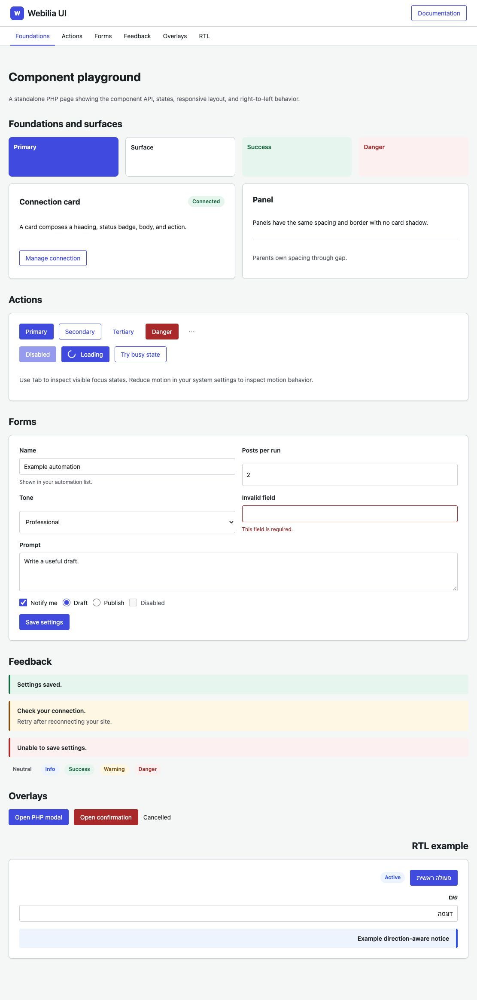

# Webilia UI

`webilia/ui` is a modular PHP, SCSS, and vanilla JavaScript UI package for Webilia products. Its core renderers work without WordPress; the WordPress asset adapter is opt-in. Version 1.2 adds reusable breadcrumb navigation.



## Install from the private repository

Add the authenticated VCS repository to the consuming project's `composer.json`:

```json
{
  "repositories": [
    { "type": "vcs", "url": "https://github.com/webilia/webilia-ui" }
  ],
  "require": {
    "webilia/ui": "^1.0"
  }
}
```

Run `composer update webilia/ui`. Configure GitHub access in the developer or CI environment; never commit a token. The package is MIT licensed, requires PHP 7.4+, and contains its compiled CSS and JS in `dist/`.

## Use the components

Render structured elements from PHP, with a `.wui` wrapper around product content:

```php
use Webilia\UI\Badge;
use Webilia\UI\Header;
use Webilia\UI\Notice;

echo '<div class="wui">';
echo Header::render([
    'title' => __('WiBee', 'wibee'),
    'home_url' => admin_url('admin.php?page=wibee'),
    'mark_html' => '<span class="wibee-logo-mark" aria-hidden="true">AI</span>',
    'nav_label' => __('WiBee sections', 'wibee'),
    'nav' => [
        ['label' => __('Home', 'wibee'), 'url' => admin_url('admin.php?page=wibee'), 'active' => true],
        ['label' => __('Automations', 'wibee'), 'url' => admin_url('admin.php?page=wibee&section=automation')],
    ],
]);
echo Badge::render(['label' => __('Connected', 'wibee'), 'tone' => 'success']);
echo Notice::render(['message' => __('Settings saved.', 'wibee'), 'tone' => 'success']);
echo '</div>';
```

The PHP renderers escape labels, titles, details, and links. `Header::mark_html`, `Modal::body_html`, and `Modal::footer_html` are deliberately **trusted HTML slots**: only pass markup assembled by the product, never raw user input. Products own translation, authorization, data validation, and business logic.

Buttons, cards, layouts, and fields use documented HTML classes rather than mandatory PHP wrappers. See [component examples](docs/components.md) and the [playground](playground/index.php).

## Load only what a screen uses

Import SCSS modules individually into your product build:

```scss
@use 'path/to/vendor/webilia/ui/assets/scss/tokens';
@use 'path/to/vendor/webilia/ui/assets/scss/components/buttons';
@use 'path/to/vendor/webilia/ui/assets/scss/components/forms';
```

Or load the matching precompiled `dist/css/tokens.css`, `buttons.css`, and `forms.css`. Every CSS rule is under `.wui`, and the tokens live on `.wui`, so a product can override a few values on its own wrapper:

```css
.wui.wibee-admin {
  --wui-color-primary: #3858e9;
  --wui-radius-md: 8px;
}
```

Interactive modules are independent. `dist/js/modal.js` installs `window.WebiliaUI.modal`; `dist/js/busy.js` installs `window.WebiliaUI.busy`; `dist/js/toast.js` installs `window.WebiliaUI.toast`. The modal module auto-initializes on `document` and also offers `init(root)` for another root. Its delegated triggers work for markup added after initial load. Built scripts expose `open`, `close`, and Promise-based `confirm`; source ESM modules are in `assets/js/` for build pipelines.

```html
<button type="button" class="wui-button" data-wui-modal-open="example">Open</button>
```

```js
const accepted = await WebiliaUI.modal.confirm({
  title: 'Delete automation?',
  message: 'This cannot be undone.',
  confirmLabel: 'Delete',
  cancelLabel: 'Cancel',
  closeLabel: 'Close dialog',
  danger: true
});
```

Translate JavaScript labels in the consuming product. Static components do not need a UI script.

Icons use explicit `wui-icon` classes; toast messages are text and never parsed as HTML. Load `icons` for standalone icons or `toast` for notifications (which also loads icons). See the [icon catalog](docs/icons.md) and [component reference](docs/components.md) for markup, font paths, toast options, and accessibility details.

### WordPress asset adapter

The adapter loads only selected styles and scripts. Call it only on your own screens and pass the URL to this package's root directory:

```php
add_action('admin_enqueue_scripts', static function ($hook): void {
    if ($hook !== 'toplevel_page_wibee') return;

    \Webilia\UI\WordPress\Assets::enqueue(
        ['header', 'layout', 'surfaces', 'forms', 'badge', 'notice', 'modal', 'busy', 'toast'],
        plugins_url('vendor/webilia/ui/', __FILE__)
    );
});
```

The adapter resolves `header → buttons`, `modal → buttons`, and `toast → icons`, and always loads tokens first. Other valid selections are `buttons`, `feedback`, and `icons`. Handles use `webilia-ui-v1-*`. Two plugins using the **same package version** share the first registered assets and the JS module initializes once. Coordinate upgrades when more than one plugin bundles Webilia UI; mixed versions are not a v1 compatibility guarantee. The package has no automatic WordPress hooks or frontend loading.

### WordPress admin headers before notices

WordPress prints admin notices before a plugin page callback. To place a Webilia UI header above those notices in the HTML, register it on WordPress's earlier `in_admin_header` hook. The adapter is opt-in and checks the current screen before resolving the product's header properties:

```php
$hook = add_menu_page(/* product page arguments */);

\Webilia\UI\WordPress\AdminHeader::register($hook, static function (): array {
    return [
        'title' => __('Example', 'example'),
        'home_url' => admin_url('admin.php?page=example'),
    ];
}, 'example-admin');
```

The adapter renders a `.wui.wui-admin-header` wrapper and accepts optional product classes for styling. Enqueue the `header` component on the same screen. Do not render the header again in the page callback. WordPress continues to render its own notices in their normal location below the header.

## Development

```bash
npm ci
npm run check
php -S 127.0.0.1:8000 -t .
```

Open `http://127.0.0.1:8000/playground/`. Build output in `dist/` is committed so Composer consumers do not need Node or Sass. See [component reference](docs/components.md) and [release guide](docs/development.md).

## Rules for product code and AI agents

1. Prefer an existing Webilia UI component for generic controls. Add a reusable missing control here before creating another product-specific version.
2. Compose product screens from components; keep product state, permissions, persistence, and workflows in the product.
3. Use `wui-` classes and semantic tokens. Do not add global `button`, `input`, or theme-wide resets.
4. Load only the component CSS and JS a screen uses. Do not introduce React for these components.
5. Preserve native control semantics, visible focus, keyboard use, responsive layout, RTL, and reduced-motion support.
