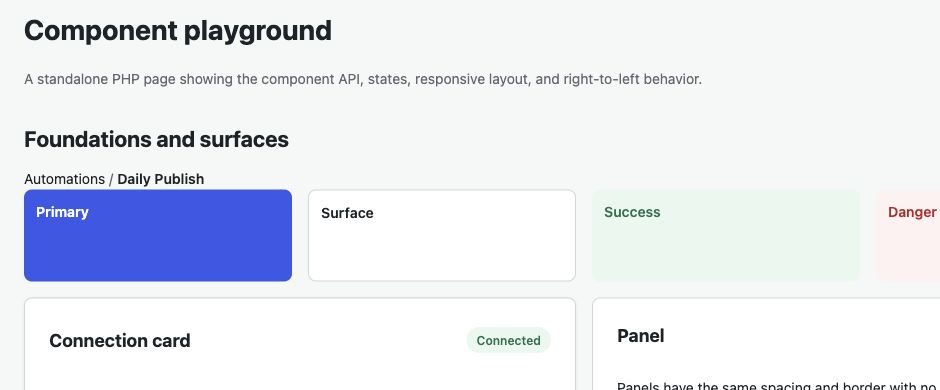
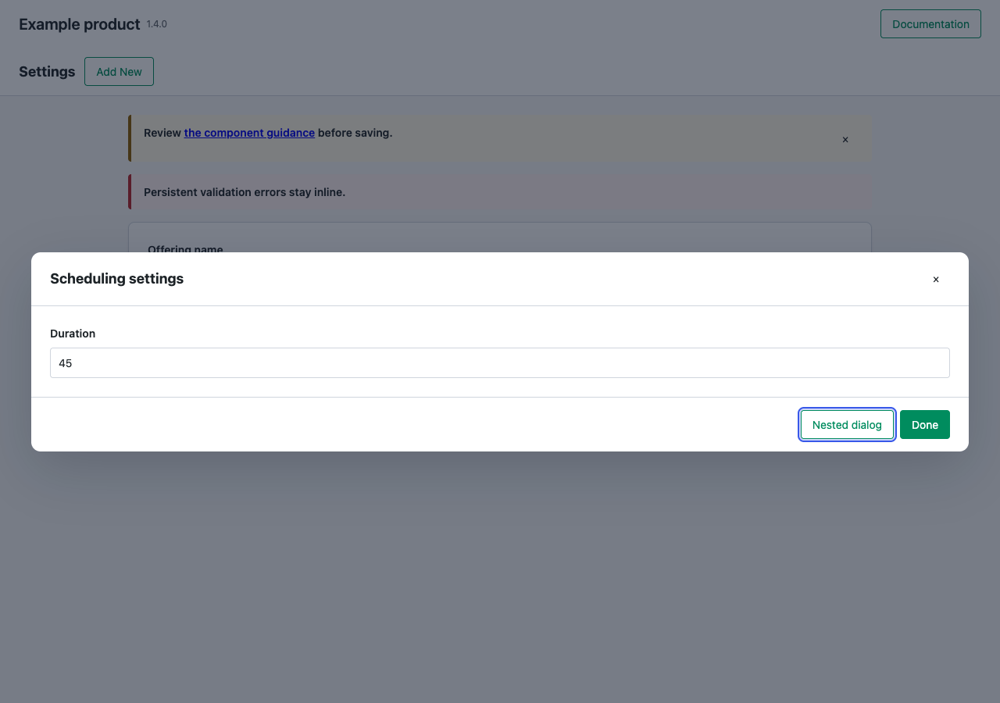
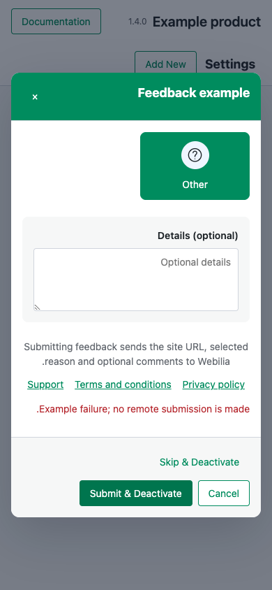
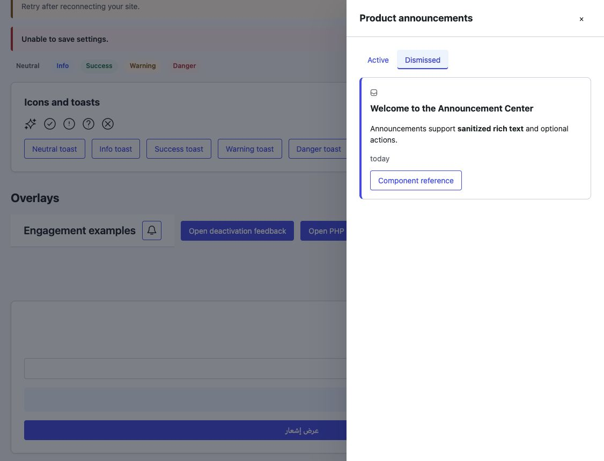
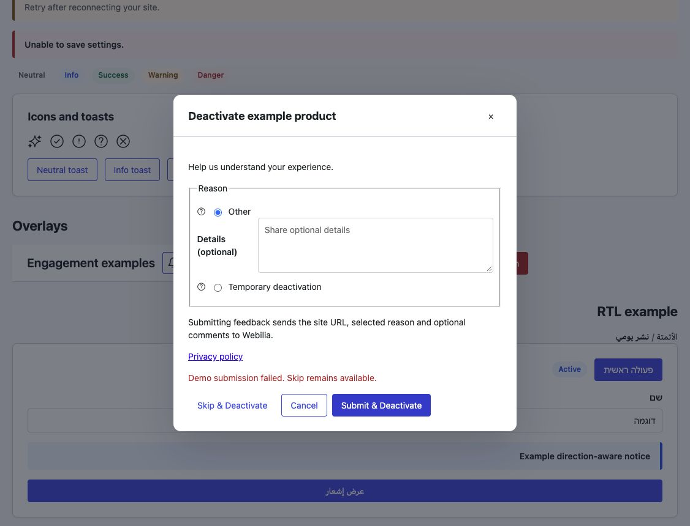
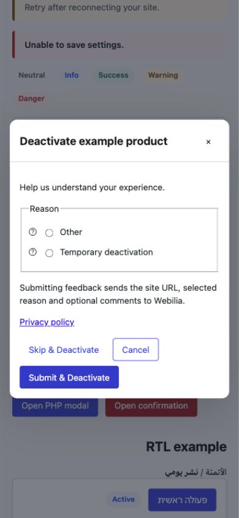

# Component reference

Load `tokens` and each component stylesheet that appears in a screen. Place ordinary content in a `.wui` wrapper. A PHP-rendered modal is itself a `.wui` root, so it may be placed directly under `body`.

| Module | CSS | JS | PHP |
| --- | --- | --- | --- |
| Tokens | `tokens` | — | — |
| Layout | `layout` | — | — |
| Buttons | `buttons` | — | — |
| Header | `header`, `buttons` | — | `Header::render()` |
| Breadcrumb | `breadcrumb` | — | `Breadcrumb::render()` |
| Forms | `forms` | — | — |
| Surfaces | `surfaces` | — | — |
| Badge | `badge` | — | `Badge::render()` |
| Notice | `notice` | — | `Notice::render()` |
| Spinner/loading | `feedback` | optional `busy` | — |
| Modal/confirmation | `modal`, `buttons` | `modal` | `Modal::render()` |
| Icons | `icons` | — | — |
| Toast | `toast`, `icons` | `toast` | — |

## Layout, buttons, and surfaces

```html
<div class="wui wui-stack wui-gap-5">
  <div class="wui-grid" style="--wui-grid-columns: 2">
    <section class="wui-card wui-section">
      <div class="wui-section__header"><h2 class="wui-section__title">Connection</h2></div>
      <p>Connected to Webilia.</p>
      <div class="wui-actions">
        <button type="button" class="wui-button">Save</button>
        <button type="button" class="wui-button wui-button--secondary">Cancel</button>
        <button type="button" class="wui-button wui-button--tertiary">Help</button>
        <button type="button" class="wui-button wui-button--danger">Delete</button>
        <button type="button" class="wui-button wui-button--icon" aria-label="More options">⋯</button>
      </div>
    </section>
    <div class="wui-panel">Another panel</div>
  </div>
</div>
```

The parent owns spacing through `gap`; components do not add outside margins. `wui-grid` stacks at 782px. Use logical CSS properties for product-specific rules so RTL works naturally.

## Fields

```html
<form class="wui-form">
  <div class="wui-field">
    <label class="wui-field__label" for="topic">Topic</label>
    <input class="wui-input" id="topic" name="topic" aria-describedby="topic-help">
    <p class="wui-field__help" id="topic-help">Optional.</p>
  </div>
  <div class="wui-field">
    <label class="wui-field__label" for="count">Post count</label>
    <input class="wui-input" type="number" id="count" name="count" min="1" aria-invalid="true" aria-describedby="count-error">
    <p class="wui-field__error" id="count-error">Enter at least one.</p>
  </div>
  <label class="wui-choice"><input type="checkbox" name="notify"> Notify me</label>
  <label class="wui-choice"><input type="radio" name="mode" value="draft"> Draft</label>
  <select class="wui-select" aria-label="Tone"><option>Professional</option></select>
  <textarea class="wui-textarea" aria-label="Prompt"></textarea>
</form>
```

Use native checkbox and radio inputs. Associate help/error text with the control using `aria-describedby`; set `aria-invalid="true"` for errors. Do not replace field validation or product data handling with UI code.

## PHP renderers

`Header::render(array $props)` accepts `title`, `home_url`, trusted `mark_html`, optional `actions` (`label`, `url`, `variant`, `new_tab`), `nav_label`, and `nav` (`label`, `url`, `active`). Empty or unsupported URLs are omitted. Navigation uses `aria-current="page"` for the active link.

`Breadcrumb::render(array $props)` accepts `items` in ancestor-to-current order, each with `label` and optional `url`, plus optional `aria_label` and `class`. The last item is always plain text with `aria-current="page"`; earlier items become links when their URLs are safe. Supply translated labels and navigation name from the product. Place the breadcrumb above the page's main section:

```php
echo Breadcrumb::render([
    'aria_label' => __('Breadcrumb', 'your-text-domain'),
    'items' => [
        ['label' => __('Automations', 'your-text-domain'), 'url' => $automations_url],
        ['label' => $automation_name],
    ],
]);
```



`Badge::render(array $props)` accepts `label` and `tone`: `neutral`, `info`, `success`, `warning`, or `danger`.

`Notice::render(array $props)` accepts `message`, optional `detail`, and `tone`: `info`, `success`, `warning`, or `danger`. Warning and danger use an alert live region; other tones use a status live region.

`Modal::render(array $props)` requires a unique `id` and accepts `title`, trusted `body_html`, trusted `footer_html`, `size` (`small`, `medium`, `large`), and translated `close_label`. The renderer returns initially hidden markup with dialog semantics. Open it with `data-wui-modal-open="id"` or `WebiliaUI.modal.open('id')`; close with `data-wui-modal-close` or `WebiliaUI.modal.close('id')`.

All renderer methods return HTML strings. They do not echo, translate, enqueue assets, or call WordPress functions. Labels and ordinary text are escaped; trusted HTML slots remain the caller's responsibility.

## Interaction and state

### Product parity options (1.4)

`Header::render()` additionally accepts escaped `version`, `page_title`, and `title_actions`
(`label`, `url`). Product branding remains in `title`; the page heading is a separate `h1`.
Consumers authorize actions before supplying them. Unsafe action URLs are omitted.

`Modal::render()` additionally accepts `size: xl`, `panel_class`, `body_class`,
`escape_close`, `backdrop_close`, `close_button` (all close options default to true),
and `mount_to_body` (default false). Supply the product theme class on the modal itself
when mounting under body. Do not remove Escape, backdrop and close-button access together
unless the body/footer provides an operable exit.

For a modal with its own form, pass `form: true` and `form_attributes`; the wrapper owns
the body and footer. Attributes accept ordinary form attributes plus `data-*` and `aria-*`;
event-handler attributes are rejected and action URLs are checked. Do not include another
form in the trusted body/footer when this wrapper is enabled.

For fields belonging to an outside form, pass `form_id` or render the modal inside that
form before opening. The controller captures the owner before optional body mounting,
sets native `form` associations, and associates dynamic controls while open and before
submission. Explicit `form` attributes and nested forms take precedence. Serialize the
actual form (`FormData(form)` or its `elements`), not only its DOM descendants.
Nested dialogs have ordered layers, focus return, and shared scroll locking.

`Notice::render()` additionally accepts `message_html` as an explicit **trusted HTML slot**;
sanitize user/API HTML before supplying it. `message` remains escaped text. Optional
`dismissible: true` and translated `dismiss_label` add a close button; enqueue
`notice-dismiss` (or load `notice.js` plus buttons) for delegated dismissal. Plain notices
remain static and persistent by default. Dismissal emits `wui:notice:dismissed` before removal.
Never turn persistent actionable errors into timed toasts.

`WebiliaUI.busy.setBusy(element, busy, { controls: iterable })` optionally selects controls,
including the element itself when it is a button. Already-disabled controls remain disabled
after loading finishes. The default still selects descendant controls only.

`DeactivationFeedbackDialog::render()` additionally accepts optional `terms_url` and
`labels.terms`, with the same URL checks and escaped labels as privacy/support links.
The WP adapter forwards these properties without adding a second transport.

The [consumer parity playground](../playground/parity.php) exercises these options.




`WebiliaUI.modal.init(root)` installs delegated click and keyboard handling once per root. Opening focuses the first control, Escape and backdrop clicks close, Tab remains within the top modal, body scrolling is locked, and focus returns to the opener. A programmatic confirmation returns `Promise<boolean>`; provide translated labels in its options. `wui:modal:opened` and `wui:modal:closed` events bubble from the modal element.

`WebiliaUI.busy.setBusy(element, true)` sets `aria-busy`, adds `wui-is-loading`, and disables controls inside the element. Calling it with `false` restores only controls that helper disabled. `WebiliaUI.busy.isBusy(element)` reports the current state. Put a `<span class="wui-spinner" aria-hidden="true"></span>` beside an accessible loading label when a visible indicator is needed.

## Icons and toast

Load the icons stylesheet and font files, then use a decorative icon beside visible text:

~~~html
<span class="wui-icon wui-icon--stars" aria-hidden="true"></span>
~~~

For an icon-only button, put the accessible label on the button. All 139 names are in the [icon catalog](icons.md). The font family and classes are distinct from the older standalone webilia/icons package, so both may appear on a page.

Toast is for short-lived feedback. It is independent of WordPress and jQuery:

~~~js
const toast = WebiliaUI.toast.show('Settings saved.', {
  root: document.querySelector('.wui'),
  tone: 'success',
  position: 'bottom-right',
  durationMs: 8000,
  progress: true,
  closeLabel: 'Dismiss notification',
});
toast.update('Save failed.', { tone: 'danger', durationMs: 8000 });
toast.dismiss();
~~~

The show method returns an object with element, update(message, options), and dismiss(). Tones are neutral, info, success, warning, danger, and loading. Positions are top-left, top-center, top-right, bottom-left, bottom-center, and bottom-right. The default duration is 8000 ms; loading defaults to no timeout. Progress is on by default for timed toasts and can be disabled with progress: false. Hover or keyboard focus pauses the remaining time. Supply translated message and closeLabel from the product. Messages use textContent; HTML is not accepted. Toasts do not move focus. Use the modal component for decisions requiring action.

The root option should be the product's .wui container so the toast inherits its color tokens. If omitted, the module creates a neutral .wui portal under body. Several toasts in the same root and position share a region. The toast stylesheet is scoped to .wui; its font-face declaration only registers a uniquely named font family.

When importing the icon SCSS into a product build, set the font URLs for that build's output location:

~~~scss
@use "path/to/vendor/webilia/ui/assets/scss/components/icons" with (
  $font-woff2-url: "/assets/fonts/webilia-ui-icons.woff2",
  $font-woff-url: "/assets/fonts/webilia-ui-icons.woff"
);
~~~

Use the default neutral tokens or override semantic `--wui-*` variables on a product's `.wui` root. Do not edit compiled component CSS to change branding.

## Announcement Center and feedback (1.4)

Header actions still accept links. A button action accepts `type: button`, `label`, `icon`, `target` (dialog ID), and optional `count`. Use `icon: bell` for the built-in SVG notification bell. `count_label` is a translated template containing `{count}`; it defaults to the label followed by the count. Zero hides the visual badge and keeps the button usable.

`AnnouncementCenter::render()` accepts `id`, `title`, `class` (consumer theme classes), `labels`, `active`, and `dismissed`. Each item accepts `id`, `title`, `description_html`, `severity`, `date` (ISO timestamp), `date_label`, and optional `url`/`cta_label`. **`description_html` is a trusted slot: sanitize it before passing it to PHP or JavaScript.** Labels include `tabs`, `active`, `dismissed`, `dismiss`, `close`, `empty_active`, `empty_dismissed`, `loading`, and `error`.

Load `modal.js` before `announcements.js`, or enqueue the `announcements` WordPress component. Initialize once per dialog:

```js
WebiliaUI.announcements.init(document.getElementById('product-announcements'), {
  items: initialItems, // each has state: 'active' or 'dismissed'
  labels: translatedLabels,
  unavailable: false,
  scope: 'site-1', // matching IDs in this scope share dismissal updates
  load: async () => ({ items: await loadItems(), unavailable: false }),
  dismiss: async id => persistDismissal(id)
});
```

`load` runs when opened; the returned controller also exposes `refresh()`. Failed retrieval/dismissal shows the configured error. Dates use localized relative calendar days in the browser’s timezone. When `items` is omitted, initialization uses the item data embedded by the PHP renderer. Numeric and string IDs are normalized to strings. Successful dismissals survive older in-flight load results and move matching IDs in mounted centers within the same scope only after persistence succeeds. Transport callbacks own authorization and HTML sanitization. Repeated initialization returns the existing controller.

`DeactivationFeedbackDialog::render()` accepts `id`, `title`, `class` (consumer theme classes), `description`, `reasons` (keyed by reason code), `disclosure`, optional `privacy_url`/`support_url`, and `labels`. Each reason contains `title`, optional icon name, and optional `placeholder` enabling an optional details textarea. Labels include `reason`, `details`, `skip`, `cancel`, `submit`, `close`, `privacy`, and `support`. Translate the disclosure and explain that submitting sends the site URL, selected reason and optional comments to Webilia.

Load `modal.js` before `deactivation.js`, or enqueue `deactivation`:

```js
WebiliaUI.deactivation.init(document.getElementById('product-feedback'), {
  reasonRequired: translatedReasonError,
  error: translatedSubmissionError, // preferred over transport rejection messages
  submit: async ({ reason, details }) => sendFeedback(reason, details),
  complete: () => followOriginalDeactivationLink(),
  skip: () => followOriginalDeactivationLink(),
  cancel: () => {} // no submission or deactivation
});
```

Only `submit` sends feedback. Failures retain Skip; cancelling prevents late submission completion from applying an action. Events are `wui:feedback:skip`, `wui:feedback:cancel`, and `wui:feedback:submitted`. These components contain no WordPress requests, plugin identity, or navigation logic. See the playground for empty states, dismissal and simulated feedback failure.

### Engagement previews





Open `/playground/?rtl=1` to exercise the full page and drawer in RTL.

The feedback dialog uses responsive icon cards backed by native radio inputs. The details area spans the full dialog width, and the footer keeps Skip separate from Cancel/Submit. Submit is associated with the form through its `form` attribute. Consumers can override `--wui-deactivation-header-bg`, `--wui-deactivation-header-ink`, `--wui-deactivation-selected-bg`, `--wui-deactivation-selected-ink`, and `--wui-deactivation-link-color`; defaults use existing semantic color tokens. Modal also accepts an escaped `description` in the header, linked with `aria-describedby`.
